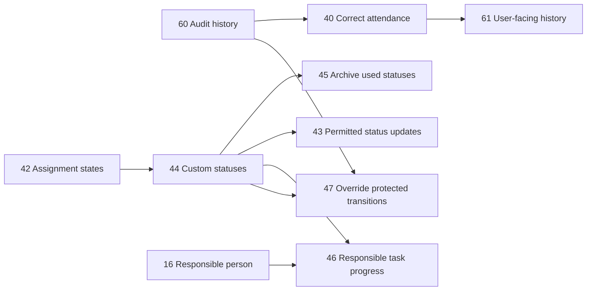

# Uge 8 – Working trees og uafhængige kritiske stier

## Indledning

I uge 8 har jeg arbejdet videre med kritiske stier og parallel udvikling i agentic development. Fokus er ikke på, hvad de enkelte slices implementerer, men på hvordan man kan organisere arbejdet, så flere dele af en kritisk sti kan udvikles uafhængigt af hinanden.

Når flere udviklere eller AI-agenter arbejder på samme projekt, er det ikke altid nødvendigt, at de arbejder i den samme mappe eller ændrer de samme filer. Hvis slices har en lav eller ingen fælles berøringsflade, kan de udvikles parallelt i separate Git working trees.

## Problemformulering

Hvordan kan Git working trees bruges til at organisere parallel udvikling på en kritisk sti, så flere slices kan arbejde uafhængigt uden at skabe unødvendige konflikter?

Jeg har især undersøgt:

- hvordan en kritisk sti kan bruges til at forstå afhængigheder
- hvordan slices kan vurderes ud fra deres berøringsflade
- hvordan working trees kan isolere parallelle arbejdsområder
- hvorfor parallel udvikling kan øge effektiviteten
- hvilke koordinationsproblemer der stadig kræver fælles aftaler

## Kritiske stier som arbejdsgrundlag

En kritisk sti viser, at opgaver eller krav ikke nødvendigvis er uafhængige. Nogle dele af projektet skal være på plads, før andre dele kan færdiggøres. Andre dele kan godt udvikles samtidig, hvis de ikke ændrer de samme arbejdsområder eller bygger på uafklarede fælles kontrakter.

Den kritiske sti kan for eksempel illustreres sådan:



Numrene i grafen fungerer som eksempler på afhængigheder. Det vigtige er ikke navnet på den enkelte slice, men forbindelsen mellem dem. Grafen hjælper teamet med at se, hvilke dele der skal koordineres, og hvilke dele der eventuelt kan udvikles parallelt.

## Working trees og parallel udvikling

Et Git working tree er en separat arbejdsmappe, som kan knyttes til en anden branch i det samme repository. Det gør det muligt at have flere arbejdsområder åbne samtidig uden hele tiden at skifte branch i den samme mappe.

Arbejdsmetoden kan beskrives i tre trin:

1. Find en kritisk sti i projektets krav eller afhængigheder.
2. Identificér hvilke dele af stien der kan udvikles uden at ændre de samme filer, moduler eller interfaces.
3. Placér de uafhængige dele i separate working trees, så de kan udvikles parallelt.

Working trees giver dermed både fysisk og organisatorisk isolation. En udvikler eller agent kan arbejde i sit eget område, mens andre arbejder videre i deres egne områder. Det mindsker risikoen for, at lokale ændringer overskriver hinanden, før de er klar til review eller integration.

## Flere AI-agenter i separate working trees

Når man arbejder med AI-agenter, kan hver agent få sit eget working tree og sin egen branch. På den måde kan flere agenter arbejde samtidig på forskellige dele af en kritisk sti uden at ændringerne blandes sammen fra begyndelsen.

En mulig arbejdsform kan se sådan ud:

```text
Agent A → Working tree A → Branch A
Agent B → Working tree B → Branch B
Agent C → Working tree C → Branch C
                         ↓
                  Review og integration
```

Hver agent får et afgrænset arbejdsområde og en tydelig prompt. Agenterne kan arbejde ud fra den samme SDD, men på hver sin branch. En agent kan for eksempel fokusere på implementation, mens en anden arbejder med tests eller dokumentation. Når arbejdet er færdigt, bliver ændringerne reviewet og samlet gennem en kontrolleret integrationsproces.

Det reducerer risikoen for, at agenter overskriver hinandens lokale ændringer. Conflicts opdages primært, når branches skal integreres, i stedet for midt i hver agents arbejde. Det gør agenternes hastighed mere kontrollerbar og giver mennesket mulighed for at fungere som koordinator og integrator.

Working trees gør dog ikke agenterne logisk uafhængige. Hvis to agenter ændrer den samme API-kontrakt, database-model eller fælles domæneregel, skal arbejdet stadig koordineres. Fordelen opstår især, når agenternes arbejdsområder har lav berøringsflade.

Flere agenter betyder heller ikke automatisk bedre udvikling. Arbejdsformen kræver tydelige acceptkriterier, branch- og working-tree-aftaler, fælles API- og domænekontrakter, Definition of Done, uafhængigt review og integrationstest. Der skal også være en ansvarlig person, som samler og godkender ændringerne.

## Fordele ved lav berøringsflade

Den største fordel opstår, når slices ikke har samme berøringsflade. Hvis to arbejdsområder ikke ændrer de samme filer eller afhænger af uafklarede fælles interfaces, behøver de ikke nødvendigvis vente på hinanden.

Det kan give:

- mindre risiko for merge conflicts
- færre ændringer i de samme filer
- mulighed for parallel udvikling
- tydeligere arbejdsområder
- mindre behov for at vente på hinanden
- bedre mulighed for at udnytte flere agenter samtidigt
- nemmere isoleret review og test
- hurtigere fremdrift på dele af den kritiske sti

Effektiviteten kommer derfor ikke primært af, at hver slice bliver hurtigere isoleret set. Den kommer af, at flere uafhængige dele kan udvikles samtidig uden at blokere hinanden.

## Working trees fjerner ikke logiske afhængigheder

Fysisk isolation er ikke det samme som logisk uafhængighed. To slices kan godt ligge i hver sin working tree og stadig afhænge af den samme API-kontrakt, database-model eller domæneregel.

Hvis en fælles aftale ikke er afklaret, kan parallel udvikling skabe forskellige fortolkninger af det samme krav. Derfor skal working trees kombineres med specifikationer, acceptkriterier og fælles tekniske beslutninger.

Når de isolerede slices skal samles, er integrationstest nødvendig. Det er først ved integrationen, at man kan se, om de separate ændringer passer sammen i det samlede system.

## Scrum og koordinering

Working trees fungerer bedst sammen med de arbejdsformer, jeg beskrev i uge 7. Scrum hjælper teamet med at koordinere de parallelle arbejdsområder gennem:

- acceptkriterier
- Definition of Done
- blockers
- stand-ups
- pull request-review
- fælles tekniske aftaler

De forskellige working trees kan derfor være isolerede, men teamets forståelse af projektet skal stadig være fælles. Stand-ups og dokumentation gør det muligt at opdage, hvis to tilsyneladende uafhængige slices alligevel begynder at påvirke hinanden.

Flere working trees kan også øge kompleksiteten. Branches kan udvikle sig forskelligt, integrationsarbejde kan vokse, og teamet skal vide, hvilken version der er den autoritative. Derfor skal hver slice have en tydelig branch, en klar Definition of Done og et aftalt tidspunkt for integration.

## Relation til SDD

Spec-driven development gør working-tree-metoden mulig, fordi specifikationen tydeliggør:

- projektets overordnede mål
- den valgte kritiske sti
- hvilke dele der afhænger af hinanden
- hvilke dele der kan afgrænses uafhængigt
- hvilke fælles kontrakter der skal overholdes

Specifikationen fungerer som koordinationsgrundlag, mens working trees fungerer som den praktiske arbejdsstruktur. SDD hjælper dermed med at definere, hvad der skal være fælles, og hvad der kan udvikles separat.

## Refleksion

Jeg ser working trees som en måde at gøre parallel udvikling mere kontrolleret. Når man tager en specifik kritisk sti og undersøger berøringsfladen mellem dens dele, kan man finde arbejdsområder, der ikke behøver at ændre de samme filer eller vente på hinanden.

Det betyder ikke, at projektet bliver simpelt. Tværtimod kræver flere isolerede arbejdsområder mere dokumentation, mere koordinering og en tydelig integrationsproces. Men kompleksiteten bliver lettere at håndtere, fordi teamet kan arbejde med mindre og mere afgrænsede områder ad gangen.

## Konklusion

I uge 8 har jeg undersøgt, hvordan Git working trees kan bruges til at organisere parallel udvikling på en kritisk sti. Ved først at forstå afhængighederne og derefter vurdere slices ud fra deres berøringsflade kan teamet finde dele, der kan udvikles uafhængigt.

Working trees reducerer risikoen for at ændre de samme filer og gør det muligt for flere udviklere eller AI-agenter at arbejde samtidigt. De fjerner dog ikke logiske afhængigheder mellem API'er, modeller og fælles domæneregler. Derfor skal fysisk isolation kombineres med SDD, Scrum, tests, dokumentation og review.

Den vigtigste læring er, at effektiv parallel udvikling ikke handler om at lade alle arbejde frit. Den handler om at vælge en kritisk sti, identificere lav berøringsflade og skabe tydelige rammer for, hvordan de isolerede dele senere integreres.

Når hver agent arbejder i sit eget working tree og på sin egen branch, kan flere dele af den kritiske sti udvikles samtidig. Det reducerer risikoen for, at agenter ændrer de samme filer, men ændrer ikke behovet for fælles specifikation, review og integration.
